<!-- Hero Card: Name, Resume Highlights, Live Status & Pure Vector SVG Color Portrait -->

  

<!-- Three World Tiles: Hardware & IoT, Full-Stack Software (UConnect), Systems & TGA -->

  
  
  

<!-- Core Engineering & Assistive Projects -->

  

<!-- Practical Systems, Engineering Experience & Technical Stack (Full Colorful Graphic Section) -->

  

<!-- Monthly Contributions Cadence & Streak Stats -->

  

<!-- 52-Week Contribution Heatmap (Ink & Cobalt Blue) -->

  

<!-- Featured Engineering Repositories (RailGuard & UConnect App) -->

  
  

<!-- Colorful Graphical Education & Verified Certifications Cards -->

  
  

---

### 📄 Verified Resume & Transmit

