<div align="center">

<!-- Hero Card: Name, Title, Live Status & Animated ASCII Circuit -->


<br/><br/>

<!-- Three World Tiles: Hardware, Software, Innovation -->
<p align="center">
  <a href="https://github.com/skmohammadali786/RailGuard"></a>
  <a href="https://github.com/skmohammadali786?tab=repositories"></a>
  <a href="https://www.skmohammadali.in"></a>
</p>

<!-- Monthly Contributions Cadence & Streak Stats -->


<br/><br/>

<!-- 52-Week Contribution Heatmap (Ink & Cobalt Blue) -->


<br/><br/>

<!-- Featured Engineering Repositories -->
<p align="center">
  <a href="https://github.com/skmohammadali786/RailGuard"></a>
  <a href="https://github.com/skmohammadali786/Bringo-deliveryagent-app"></a>
</p>

</div>

---

### ⚡ Practical Systems & Technical Stack

```text
┌─────────────────┬────────────────────────────────────────────────────────┐
│ DOMAIN          │ TECHNOLOGIES & TOOLS                                   │
├─────────────────┼────────────────────────────────────────────────────────┤
│ Embedded & IoT  │ C, C++, Arduino, ESP32, Raspberry Pi, PlatformIO, PCB  │
│ Full-Stack & App│ TypeScript, Next.js, React Native, Node.js, FastAPI    │
│ Systems & Data  │ Python, PostgreSQL, Redis, Supabase, Docker, Linux     │
│ UI & Prototyping│ Tailwind CSS, Figma, Three.js, REST & WebSocket APIs   │
└─────────────────┴────────────────────────────────────────────────────────┘
```

---

<div align="center">

### 🌐 Connect & Transmit

[](https://www.skmohammadali.in/)
[](https://linkedin.com/in/skmohammadali)
[](https://x.com/Skmohammadali_)
[](mailto:connect@skmohammadali.in)
[](https://www.skmohammadali.in/resume.pdf)

<sub>Built with animated editorial SVG cards · Refreshed daily via GitHub Actions · Inspired by Avi Vashishta</sub>

</div>
